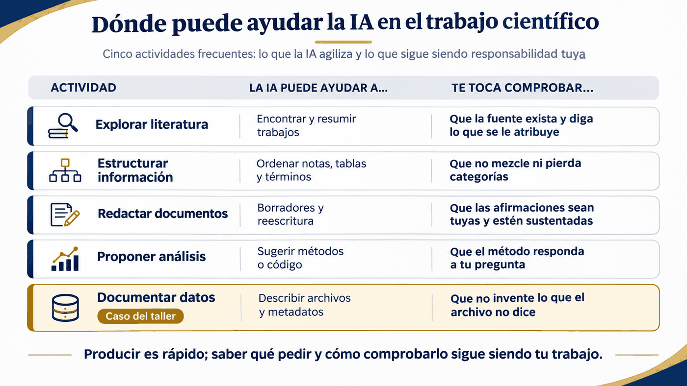

::: {.etiqueta-pagina .antes}
Antes o durante el taller
:::

::: {.en-un-minuto}
- Con IA, producir resultados es fácil; **saber qué producir y cómo verificarlo** se vuelve más importante.
- El riesgo: respuestas convincentes basadas en **supuestos que los datos no respaldan**.
- El taller propone **seis etapas** para pasar de una necesidad ambigua a un resultado verificable y documentado.
:::

## La transformación del trabajo científico con IA

La inteligencia artificial está transformando muchas actividades científicas. La IA puede ayudar a explorar literatura, estructurar información, redactar documentos, proponer análisis y preparar documentación de datos. Que produzca resultados con rapidez no significa que haya interpretado correctamente el objetivo de quien investiga ni que las afirmaciones sean válidas.

{fig-alt="Infografía en forma de tabla. Título: Dónde puede ayudar la IA en el trabajo científico. Columnas: actividad, la IA puede ayudar a, te toca comprobar. Explorar literatura: encontrar y resumir trabajos; comprobar que la fuente exista y diga lo que se le atribuye. Estructurar información: ordenar notas, tablas y términos; comprobar que no mezcle ni pierda categorías. Redactar documentos: borradores y reescritura; comprobar que las afirmaciones sean tuyas y estén sustentadas. Proponer análisis: sugerir métodos o código; comprobar que el método responda a tu pregunta. Documentar datos, destacado como caso del taller: describir archivos y metadatos; comprobar que no invente lo que el archivo no dice. Pie: producir es rápido; saber qué pedir y cómo comprobarlo sigue siendo tu trabajo."}

**Un antecedente útil viene de la ingeniería de software.** Allí, los asistentes permiten delegar partes de la implementación; como consecuencia, cobran mayor relevancia la definición de necesidades, las especificaciones, los criterios de aceptación y la revisión de los resultados. El enfoque *Spec-Driven Development* insiste en conservar la intención del producto desde los requisitos hasta la validación [[R11](08-referencias.qmd#r11)]. Martin Fowler denomina *Agentic Engineering* a una práctica en la que agentes producen o modifican código mientras las personas conservan la responsabilidad de revisarlo y comprenderlo [[R12](08-referencias.qmd#r12)]. Estas son **descripciones y propuestas del ámbito de software**, no pruebas de que todo trabajo de programación haya cambiado del mismo modo ni garantías automáticas de productividad o calidad.

::: {.destacado}
Cuando producir resultados se vuelve más fácil, saber qué producir y cómo verificarlo se vuelve aún más importante.
:::

La analogía tiene límites: en investigación a menudo **no conocemos de antemano la respuesta correcta**. No se trata de trasladar mecánicamente pruebas de software al trabajo científico, sino de definir qué se puede verificar: procedencia, supuestos, métodos, consistencia, datos y solidez de las conclusiones.

## El problema: respuestas plausibles que los datos no respaldan

Los asistentes actuales pueden interpretar instrucciones ambiguas, sugerir opciones y completar información implícita. Esa capacidad es útil, pero también puede producir explicaciones convincentes basadas en **supuestos que no están respaldados por los datos**. Este riesgo no es exclusivo de los modelos: quienes investigan también pueden introducir inferencias plausibles que no corresponden a hechos observados.

En una matriz de expresión génica, por ejemplo, un modelo puede identificar genes y comparar valores, pero no puede establecer con certeza unidades, réplicas o tratamientos si esa información no figura en el archivo ni en otras fuentes fiables. Una inferencia biológicamente razonable no autoriza a completar los metadatos experimentales como si fueran hechos.

El problema no es solamente cómo escribir instrucciones más elaboradas. También es **reconocer qué sabemos, qué desconocemos, qué estamos suponiendo y qué podemos justificar con evidencia**.

::: {.destacado}
No se trata de hacer el trabajo antes que la IA, sino de comprenderlo lo suficiente para saber qué delegar, qué esperar y qué verificar.
:::

## La propuesta de «Antes del prompt»

Este taller plantea una secuencia **iterativa de seis etapas** para transformar necesidades de investigación expresadas informalmente en tareas delimitadas, resultados evaluables y decisiones documentadas. Integra competencias de **AI Fluency 4D** [[R1](08-referencias.qmd#r1)], alfabetización informacional [[R2](08-referencias.qmd#r2)], descomposición y criterios de aceptación [[R3](08-referencias.qmd#r3)], y buenas prácticas de verificación y documentación [[R4](08-referencias.qmd#r4), [R6](08-referencias.qmd#r6), [R10](08-referencias.qmd#r10)]. Las prácticas de especificación en desarrollo de software [[R11](08-referencias.qmd#r11), [R12](08-referencias.qmd#r12)] sirven como **antecedente conceptual y analogía**, no como metodología formal aplicable sin cambios a toda investigación. La secuencia concreta es una **síntesis didáctica desarrollada para este taller con asistencia de IA**; no se presenta como un método estandarizado ni como una intervención con eficacia pedagógica validada (véase [la procedencia del enfoque](03-metodo.qmd#procedencia-del-enfoque)).

Los **prompts se usan desde el comienzo**, incluso para reconocer conceptos desconocidos y pedir explicaciones. «Antes del prompt» no significa esperar para conversar con IA; significa **pensar antes de delegar una solución sin comprender suficientemente la tarea**. El propósito no es enseñar fórmulas rígidas, sino decidir qué pedir, qué recursos utilizar y cómo evaluar lo recibido.

El caso de estudio es una situación cotidiana en investigación: una investigadora tiene un Excel con expresión génica bajo tres condiciones, asociado a una publicación, y le piden preparar sus datos siguiendo los principios FAIR. Las personas participantes investigarán términos, revisarán la información disponible, identificarán ausencias, formularán un encargo razonable y contrastarán recomendaciones.

## Dos públicos, una misma habilidad

- **Quien publica un dataset:** necesita comprender condiciones de uso, metadatos, fuentes, formatos, políticas editoriales y repositorios apropiados.
- **Quien mantiene una base de datos:** debe considerar identificadores, descripción, acceso, interoperabilidad, procedencia, versiones y reutilización; a otra escala y con desafíos técnicos adicionales.

El taller no implementa una base de datos ni deposita datasets. Busca reconocer **preguntas compartidas** entre ambas situaciones.
