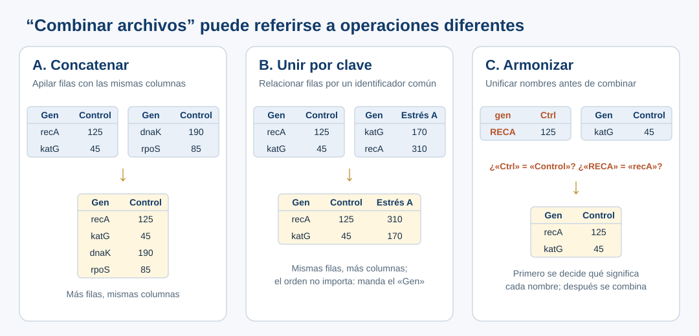

::: {.etiqueta-pagina .durante}
Durante el taller · lectura de 4 min
:::

::: {.en-un-minuto}
- Tres fallas distintas: **tarea indefinida**, **cita real que no respalda la afirmación** y **metadatos inventados**.
- Ninguna se resuelve solo con un prompt más largo.
- Las respuestas de la IA son **simulaciones** preparadas para el taller.
:::

## Conceptos introductorios

| Concepto | Definición operativa | Advertencia |
|---|---|---|
| Modelo de lenguaje (LLM) | Sistema capaz de generar texto y otras salidas a partir de patrones aprendidos y del contexto que recibe. | No debe asumirse que toda afirmación viene de una fuente comprobada. |
| Prompt | Pregunta, instrucción y/o contexto proporcionado al sistema. | Se usan prompts desde la primera exploración; no existe un único prompt perfecto. |
| Contexto | Antecedentes, datos, fuentes, objetivo, audiencia, restricciones y convenciones pertinentes. | No reemplaza la información experimental faltante. |
| Supuesto | Información que se da por cierta o se introduce para completar una tarea. | Debe distinguirse un supuesto autorizado de uno no respaldado. |
| Inferencia | Conclusión derivada de datos o premisas. | Puede ser plausible sin estar demostrada por el material aportado. |
| Alucinación | Contenido falso, inventado o no sustentado presentado como si fuese válido. | Una cita con formato correcto puede no existir o no sustentar el argumento. |
| Verificación | Contraste con datos, fuentes, criterios o procedimientos externos a la mera afirmación de la IA. | Pedirle al mismo modelo «¿estás seguro?» no equivale a verificar. |
| Especificación | Descripción de una tarea que define propósito, entradas, alcance, límites, entregable y criterios de aceptación. | Más detalle no siempre implica mejor resultado si el problema sigue mal definido. |
| Trazabilidad | Registro que permite reconstruir fuentes, decisiones, transformaciones y revisiones. | Guardar únicamente el último prompt resulta insuficiente en muchos contextos. |
| FAIR | Principios para que datos y recursos digitales sean encontrables, accesibles, interoperables y reutilizables. | FAIR no equivale a «abierto», a un formato particular ni a un sí/no universal. |

::: {.callout-tip}
## Idea clave
Algunos problemas no se resuelven con un prompt más largo, sino aprendiendo conceptos, aportando datos, delimitando expectativas o contrastando evidencia.
:::

## Tres ejemplos para discutir

Los términos *Description*, *Discernment* y *Diligence* corresponden a las competencias del [marco AI Fluency 4D](03-metodo.qmd#ai-fluency-4d-marco-de-competencias), que se presenta en la página siguiente; la cuarta, *Delegation*, se trabaja en la práctica.

### Ejemplo 1. Respuesta válida a un encargo ambiguo

::: {.prompt data-label="Solicitud" data-meta="lo que escribe la investigadora" data-copy="no"}
Tengo tres archivos con información de genes. Necesito combinarlos en una tabla
:::

::: {.respuesta-ia data-label="Respuesta simulada"}
Aquí tienes un script que concatena los tres archivos en una sola tabla.
:::

**Qué falla:** la respuesta es técnicamente correcta, pero «combinar» admite varias operaciones:

- **Concatenar:** apilar filas si comparten estructura.
- **Unir por clave (*join*):** relacionar filas por identificadores comunes.
- **Armonizar:** resolver sinonimias o columnas con significados/formatos diferentes antes de combinar.

Armonizar suele ser un paso previo a cualquiera de las otras dos. La IA eligió una operación razonable sin saber cuál necesitaba realmente la investigadora: quizá lo que hacía falta era unir por identificador de gen.

{fig-alt="Tres paneles con tablas pequeñas. A, concatenar: dos tablas con columnas Gen y Control se apilan en una de cuatro filas. B, unir por clave: una tabla con Control y otra con Estrés A se relacionan por el gen, aunque estén en distinto orden. C, armonizar: una tabla usa gen, Ctrl y RECA y otra Gen, Control y katG; primero se decide si significan lo mismo y luego se combinan."}

**Preguntas para el grupo:** ¿Qué significa «combinar»? ¿Qué información faltó? ¿En qué casos una solución técnicamente correcta respondería al problema equivocado?

**Qué hacer:** pedir primero: «¿Qué operaciones podrían corresponder a mi necesidad? Muéstrame entradas/salidas mínimas y pregunta qué necesitas saber antes de recomendar una». Después, comprobar con dos o tres genes que la tabla resultante contiene lo esperado.

**Conceptos trabajados:** ambigüedad, vocabulario, criterios de aceptación, [*Description*](03-metodo.qmd#ai-fluency-4d-marco-de-competencias).

### Ejemplo 2. La referencia existe, pero no demuestra lo que se le atribuye

::: {.prompt data-label="Solicitud" data-meta="lo que escribe la investigadora" data-copy="no"}
Busca evidencia científica de que adoptar FAIR mejora la reproducibilidad de la investigación
:::

::: {.respuesta-ia .incorrecta data-label="Respuesta simulada · deliberadamente incorrecta"}
Wilkinson et al. (2016) demostraron que implementar FAIR aumenta la reproducibilidad científica un 80 %.

Wilkinson, M. D. et al. (2016). *The FAIR Guiding Principles for scientific data management and stewardship*. *Scientific Data*, 3, 160018. https://doi.org/10.1038/sdata.2016.18
:::

**Qué falla:** **la referencia y el DOI son auténticos**. El artículo presenta los principios FAIR, su justificación y ejemplos, **pero no demuestra empíricamente un incremento del 80 % en reproducibilidad**. Esa cifra se ha añadido deliberadamente en la simulación y no debe citarse como hallazgo real [R5].

**Preguntas para el grupo:** ¿Existe el artículo? ¿Su DOI es correcto? ¿Trata sobre FAIR? ¿Sustenta la afirmación cuantitativa? ¿Qué evidencia se necesitaría para sostenerla?

**Qué hacer:** revisar la publicación original, identificar su tipo de contribución y buscar en ella el supuesto dato del 80 %. Estar ante una referencia real **no basta** para validar una afirmación.

**Conceptos trabajados:** referencia verificable frente a afirmación respaldada, atribución incorrecta, [*Discernment*](03-metodo.qmd#ai-fluency-4d-marco-de-competencias).

### Ejemplo 3. La IA inventa metadatos experimentales

::: {.prompt data-label="Solicitud" data-meta="lo que escribe la investigadora" data-copy="no"}
Aquí está mi Excel de genes bajo tres condiciones. Ayúdame a documentarlo para hacerlo FAIR
:::

::: {.respuesta-ia .incorrecta data-label="Respuesta simulada · problemática"}
Los valores corresponden a TPM de RNA-seq con tres réplicas biológicas por condición; Estrés A indica estrés oxidativo.
:::

**Qué falla:** nada de eso puede determinarse con la tabla de ejemplo. Puede requerirse confirmación experimental externa.

**Preguntas para el grupo:** ¿Qué se puede observar directamente en el archivo? ¿Qué información necesita confirmación de la investigadora? ¿Cuál es el riesgo de escribir documentación falsa y reutilizarla?

**Qué hacer:** pedir a la IA que separe lo que **se observa en el archivo**, lo que **infiere** y lo que **debe confirmar la investigadora**, y que deje vacíos los campos que no puede establecer en lugar de rellenarlos.

**Conceptos trabajados:** diferencia entre dato e interpretación, procedencia, incertidumbre, [*Diligence*](03-metodo.qmd#ai-fluency-4d-marco-de-competencias).

### Cierre de los ejemplos

Las tres fallas son distintas: **(1) tarea indefinida; (2) evidencia no confirmada; (3) supuestos presentados como hechos**. Las respuestas se prepararon de antemano para ilustrar cada falla; un modelo real puede o no cometerlas en una sesión dada.
