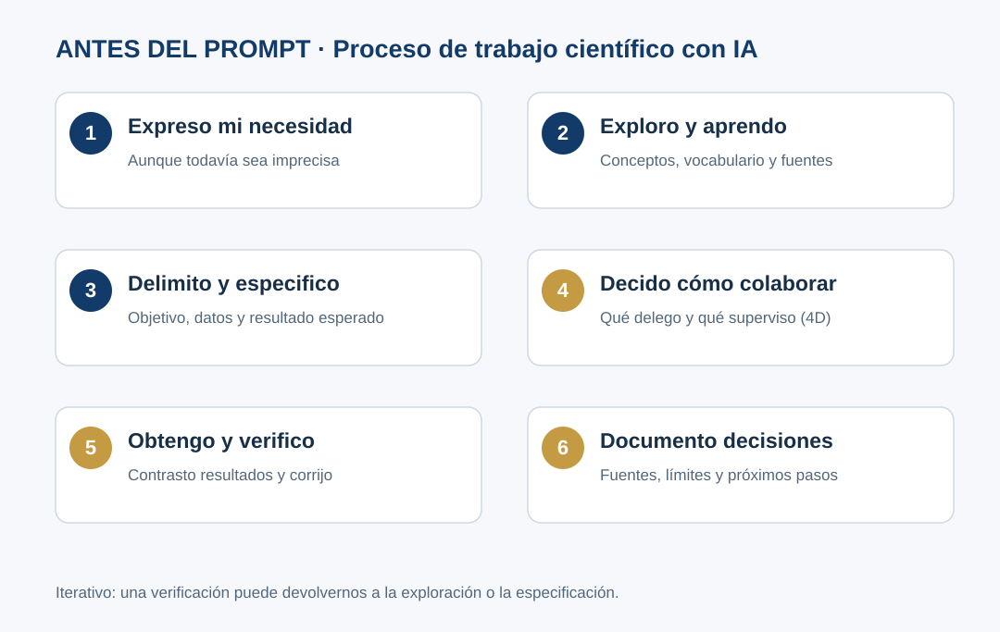
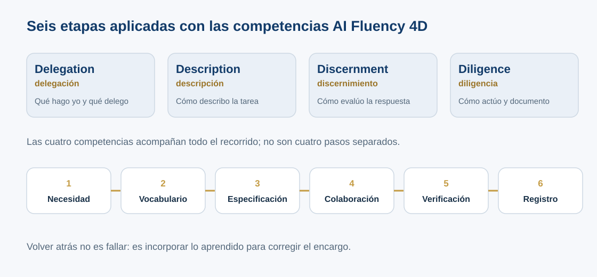

::: {.etiqueta-pagina .antes}
Antes del taller
:::

::: {.en-un-minuto}
- Seis etapas iterativas: **necesidad, vocabulario, especificación, colaboración, verificación y registro**.
- Las competencias **4D** (Delegation, Description, Discernment, Diligence) acompañan todas las etapas.
- Es una síntesis didáctica apoyada en fuentes, no un método validado.
:::

## Las seis etapas y el marco 4D

Las seis etapas son una adaptación didáctica desarrollada para este taller; en [Procedencia del enfoque](#procedencia-del-enfoque) se explica en qué fuentes se apoya cada una y qué no puede afirmarse.

{fig-alt="Diagrama de seis etapas iterativas: expreso mi necesidad, exploro y aprendo, delimito y especifico, decido cómo colaborar, obtengo y verifico, documento decisiones"}

**Las seis etapas** (entre paréntesis, el nombre corto que usamos en tablas y diagramas):

1. **Expreso lo que necesito, aunque todavía no sea preciso** (Necesidad). ¿Qué quiero lograr?
2. **Identifico lo que desconozco y aprendo el vocabulario necesario** (Vocabulario). ¿Qué debo comprender antes de tomar decisiones?
3. **Delimito el problema y establezco qué resultado necesito** (Especificación). ¿Qué entradas, alcance, entregable y criterios necesito?
4. **Decido cómo colaborar con la IA utilizando las competencias 4D** (Colaboración). ¿Qué delego y qué superviso?
5. **Obtengo un resultado, lo contrasto y corrijo sus limitaciones** (Verificación). ¿Qué evidencia permite aceptarlo?
6. **Documento cómo llegué a él y qué decisiones tomé** (Registro). ¿Cómo lo entenderá o revisará otra persona?

**No es un flujo lineal obligatorio:** un resultado incorrecto puede obligar a regresar a aprender vocabulario, corregir la especificación o reformular el problema.

### AI Fluency 4D: marco de competencias

El marco AI Fluency de Rick Dakan y Joseph Feller, desarrollado en colaboración con Anthropic [R1], identifica cuatro competencias interrelacionadas. Conservamos los nombres en inglés, como aparecen en el marco:

| D | Competencia | Pregunta útil en el taller |
|---|---|---|
| **Delegation** (delegación) | Determinar metas y decidir si, cuándo y cómo usar IA. | ¿Qué le encargo a la IA y qué hago/decido yo? |
| **Description** (descripción) | Comunicar metas y contexto para orientar el trabajo. | ¿He explicado datos, condiciones y resultado esperado? |
| **Discernment** (discernimiento) | Evaluar críticamente productos y comportamiento de IA. | ¿Qué parte está comprobada y qué parte debo cuestionar? |
| **Diligence** (diligencia) | Asumir responsabilidad y actuar apropiadamente. | ¿Qué debo registrar, proteger, atribuir y revisar antes de difundir? |

Estas competencias no corresponden una a una a las etapas. Por ejemplo, la exploración también usa Description y Discernment; la verificación puede modificar la Delegation. El taller **aplica** el marco 4D, pero no pretende presentarse como una metodología oficial de Anthropic.

{fig-alt="Diagrama de las competencias Delegation, Description, Discernment y Diligence acompañando las seis etapas: necesidad, vocabulario, especificación, colaboración, verificación y registro"}

### Mapa didáctico orientativo

| Etapa | 4D particularmente visibles | Evidencia observable |
|---|---|---|
| 1. Necesidad | Delegation | Reconoce el propósito y lo que no sabe |
| 2. Vocabulario | Description, Discernment | Distingue términos y confirma definiciones |
| 3. Especificación | Delegation, Description | Define alcance, datos y entregable |
| 4. Colaboración | Todas | Delimita IA/humano y supervisión |
| 5. Verificación | Discernment, Description | Detecta supuestos y corrige |
| 6. Registro | Diligence | Conserva fuentes, decisiones y pendientes |

### Advertencia transversal sobre inferencias

La IA actual puede formular preguntas acertadas y completar contexto con mucha soltura. Esto no autoriza convertir una hipótesis en metadatos observacionales. La misma cautela aplica a las inferencias humanas: una persona experta podría asociar `katG` con estrés oxidativo y concluir precipitadamente que una condición sin describir lo representa.

### ¿Siempre hay que recorrer las seis etapas?

No. El proceso es proporcional: se usa completo cuando la decisión tiene consecuencias (publicar datos, compartirlos o interpretarlos) y se comprime cuando la consulta es trivial.

## Procedencia del enfoque

La metodología *«Antes del prompt»* es una **síntesis didáctica del equipo docente desarrollada con asistencia de IA**. La formulación concreta, el orden y la combinación de seis etapas responden a las necesidades del taller. La literatura citada **respalda prácticas o competencias componentes**, pero no valida la secuencia completa ni su eficacia pedagógica.

| Etapa propuesta en el taller | Fundamento o práctica vinculada | Alcance de la relación |
|---|---|---|
| 1. Necesidad: expreso lo que necesito | Investigación como indagación y búsqueda estratégica [R2]; Delegation [R1] | Inspiración conceptual; formulación propia |
| 2. Vocabulario: identifico lo que desconozco y aprendo el vocabulario necesario | Búsqueda iterativa, lenguaje especializado y contraste de fuentes [R2] | Fundamento directo para explorar términos, no una técnica exclusiva de IA |
| 3. Especificación: delimito el problema y establezco qué resultado necesito | Descomposición y criterios de aceptación [R3]; prácticas de especificación [R11]; Description [R1] | Adaptación desde desarrollo de productos a tareas científicas cotidianas |
| 4. Colaboración: decido cómo colaborar con la IA | Cuatro competencias del 4D [R1] | Uso explícito del marco; 4D es transversal a todas las etapas |
| 5. Verificación: obtengo un resultado, lo contrasto y corrijo | Discernment [R1]; gestión de riesgos y evaluación [R4]; revisión humana en ingeniería asistida [R12] | El contraste científico exige fuentes y criterios adecuados a cada tarea |
| 6. Registro: documento cómo llegué al resultado y qué decidí | Diligence [R1]; documentación de datos [R6] y buenas prácticas [R10] | Adaptación a bitácora; no implica por sí sola que el resultado sea reproducible o FAIR |

### Qué puede afirmarse, y qué no

- **Sí:** el taller está **fundamentado en** AI Fluency 4D y toma elementos de alfabetización informacional, especificación, verificación y documentación.
- **Sí:** se propone una secuencia iterativa de seis momentos aplicables al caso de datos científicos.
- **No:** que «Antes del prompt» sea una metodología científica estandarizada o validada por Anthropic, ACRL, NIST o ELIXIR.
- **No:** que los resultados de una respuesta de IA o una lista de cotejo certifiquen que un dataset cumple FAIR.

Si vas a reutilizar o citar este enfoque, consulta [Cómo citar este material](08-referencias.qmd#cómo-citar-este-material).

::: {.callout-tip}
## Delimitar no es todavía redactar el prompt
Una vez definido el producto esperado (etapa 3), utiliza la [anatomía del prompt](03b-estructura-prompt.qmd) para traducirlo a instrucciones (etapa 4). Esto no añade una séptima etapa.
:::
