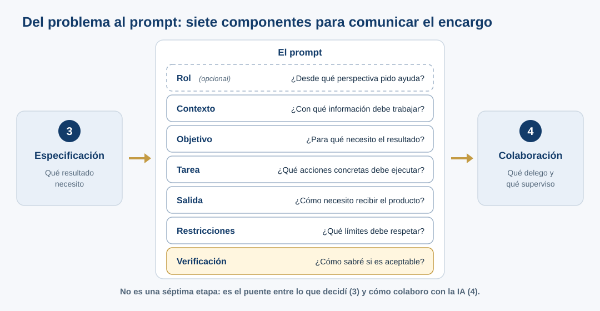

::: {.etiqueta-pagina .durante}
Durante el taller
:::

::: {.en-un-minuto}
- **El prompt no sustituye la comprensión del problema**: comunica lo que ya decidiste.
- Siete componentes: rol (opcional), contexto, objetivo, tarea, salida, restricciones y verificación.
- Una instrucción más detallada da respuestas **más fáciles de revisar**, no necesariamente más verdaderas.
:::

## ¿Por qué hablar de prompting en este taller?

En [¿Qué falta por definir?](interactivos/que-falta-por-definir.qmd) reformulaste una solicitud y anotaste lo que faltaba decidir ([etapas 1 a 3](03-metodo.qmd)). Ahora toca traducirla en instrucciones para la IA (etapa 4). **La estructura del prompt es el puente entre la especificación y la colaboración**: convierte una necesidad definida en un encargo concreto. No existe una plantilla universal obligatoria, ni todos sus elementos tienen que aparecer en cualquier consulta. Esta es una **herramienta pedagógica flexible**, útil cuando una tarea científica tiene incertidumbres, datos propios o consecuencias de publicación.

## Siete componentes y su efecto esperado

{fig-alt="Diagrama: a la izquierda la etapa 3, Especificación (qué resultado necesito); al centro el prompt con siete componentes y su pregunta: Rol (opcional), Contexto, Objetivo, Tarea, Salida, Restricciones y Verificación; a la derecha la etapa 4, Colaboración (qué delego y qué superviso). Nota: no es una séptima etapa, sino el puente entre ambas."}

| Componente | Pregunta que resuelve | Qué puede cambiar en la salida | Precaución |
|---|---|---|---|
| **Rol** | ¿Desde qué perspectiva pido ayuda? | Terminología, enfoque, profundidad y criterios a considerar | «Actúa como experto» no demuestra competencia ni aporta evidencia ausente. |
| **Contexto** | ¿Con qué información debe trabajar? | Pertinencia de supuestos y referencias al caso | Contexto incompleto o incorrecto puede propagarse. |
| **Objetivo** | ¿Para qué necesito el resultado? | Prioridad y dirección de la respuesta | «Hacer FAIR» es demasiado amplio si no se define el alcance. |
| **Tarea** | ¿Qué acciones concretas debe ejecutar? | Tipo de análisis, pasos y cobertura | Una lista de tareas no autoriza inventar datos. |
| **Salida** | ¿Cómo necesito recibir el producto? | Estructura, columnas, longitud y posibilidad de revisión | Una tabla impecable puede contener afirmaciones incorrectas. |
| **Restricciones** | ¿Qué límites debe respetar? | Reducción de transformaciones o afirmaciones no autorizadas | No sustituyen la inspección del resultado. |
| **Verificación** | ¿Cómo sabré si es aceptable? | Trazas de evidencia, fuentes, incertidumbre y pendientes | Pedir citas no equivale a leer ni contrastar las fuentes. |

::: {.callout-note}
## ¿Qué componente es más importante?
En muchas tareas importan más **objetivo, contexto, tarea y verificación** (criterios de aceptación) que asignar un rol llamativo. El rol es opcional: no hace que el sistema adquiera conocimientos experimentales que no están en el archivo.
:::

## Un mismo caso: dos solicitudes

Como ejemplo resuelto usamos el [Excel simulado de expresión génica](../descargas/expresion_genica_caso_simulado.xlsx) del [caso de estudio](04-caso-fair.qmd), con el que trabajarás al final del taller. Tiene dos hojas (los datos y unas notas experimentales parciales), cinco filas de genes, tres columnas de condiciones y una celda vacía; **no hay suficiente información para establecer las unidades, el método, las réplicas ni las condiciones experimentales exactas**.

### A. Solicitud abierta (P0)

::: {.prompt data-label="P0" data-meta="solicitud abierta"}
Tengo este Excel de expresión génica de cinco filas y tres condiciones. Voy a publicar un artículo y me piden que los datos sigan los principios FAIR. ¿Me ayudas a prepararlo?
:::

Es una consulta auténtica y razonable. La IA puede ofrecer una respuesta útil, pero debe decidir por su cuenta si explicar conceptos, pedir detalles, proponer un plan o producir archivos.

### B. Solicitud delimitada

::: {.panel-tabset}
## Con etiquetas

::: {.prompt .estructurado data-label="Versión B" data-meta="solicitud delimitada"}
**Rol (opcional):** Ayúdame desde la perspectiva de gestión de datos científicos.

**Contexto:** Tengo un Excel simulado de expresión génica con cinco filas de genes y tres condiciones, destinado a un ejercicio sobre FAIR.

**Objetivo:** Identificar la información que falta **antes** de preparar un depósito o afirmar cumplimiento FAIR.

**Tarea:** Revisa encabezados, valores y notas; identifica incertidumbres sobre unidades, condiciones, réplicas y celda vacía.

**Salida:** Entrega una tabla con asunto, evidencia localizable en hoja/celda, información por confirmar, siguiente acción y responsable propuesto.

**Restricciones:** No inventes unidades, tratamientos, cepa, métodos, réplicas ni el significado de «prom.». No sustituyas celdas vacías por cero ni modifiques los datos.

**Verificación:** Separa lo observado de las inferencias y de lo que requiere consulta externa. Indica qué habría que verificar y dónde; no declares una verificación que no realizaste.
:::

## De corrido

::: {.prompt data-label="Versión B" data-meta="la misma solicitud, sin etiquetas"}
Ayúdame, desde la perspectiva de gestión de datos científicos, a revisar un Excel simulado de expresión génica con cinco filas de genes y tres condiciones, destinado a un ejercicio sobre FAIR. Antes de preparar un depósito o afirmar cumplimiento FAIR, necesito identificar la información que falta. Revisa encabezados, valores y notas, e identifica las incertidumbres sobre unidades, condiciones, réplicas y la celda vacía. Entrégame una tabla con el asunto, la evidencia localizable en hoja y celda, la información por confirmar, la siguiente acción y el responsable propuesto. No inventes unidades, tratamientos, cepa, métodos, réplicas ni el significado de «prom.»; no sustituyas celdas vacías por cero ni modifiques los datos. Separa lo observado de las inferencias y de lo que requiere consulta externa, e indica qué habría que verificar y dónde, sin declarar una verificación que no realizaste.
:::
:::

Las etiquetas no son obligatorias: la IA entiende igual la versión de corrido. Sirven para comprobar que no falta ningún componente; úsalas mientras aprendes o cuando el encargo es largo.

La segunda versión **no es una respuesta al problema**: es una mejor delimitación del encargo. Esperamos una salida más fácil de revisar, **no necesariamente más verdadera**.

## Qué cambia al añadir cada componente

Imagina que ya proporcionaste el Excel y una tarea breve: «Revisa los datos y dime qué falta». Esto es lo que suele cambiar al añadir algunos componentes:

| Si añades… | Sin él, es frecuente que la IA… | Con él, deberías notar que… |
|---|---|---|
| **Objetivo** («necesito un diagnóstico preliminar, no archivos para publicar») | proponga README, CSV y metadatos como si fueras a publicar | se limita a un diagnóstico preliminar |
| **Salida** («tabla de cuatro asuntos con evidencia») | responda en párrafos difíciles de revisar | entrega una tabla en la que cada afirmación se revisa por separado |
| **Restricciones** («no inventes unidades ni réplicas») | complete unidades o réplicas «razonables» | marca esos datos como pendientes |
| **Verificación** («indica celdas y fuentes aún no consultadas») | mezcle lo observado con lo supuesto | separa lo observado, lo inferido y lo que falta consultar |

Son patrones frecuentes, no resultados garantizados. Una misma instrucción puede dar respuestas distintas cada vez, así que comparar dos versiones muestra diferencias, pero no prueba que las causó el cambio en el prompt.

## Errores frecuentes

- Creer que mencionar un **rol experto** garantiza exactitud.
- Confundir **objetivo** («preparar datos para publicación») con **tarea inmediata** («diagnosticar información faltante»).
- Pedir una **salida convincente** sin fijar criterios de revisión.
- Exigir «fuentes» y dar por hecho que el modelo las leyó o que respaldan exactamente la afirmación.
- Escribir restricciones pero omitir la **verificación humana e independiente**.
- Tratar el prompt como un texto fijo: se puede revisar conforme aprendemos y delimitamos el problema.

## Conexión con AI Fluency 4D

Escribir un prompt es sobre todo **Description (descripción)**, pero las otras tres competencias también intervienen: decides qué delegas, anticipas cómo revisarás la respuesta y te haces responsable de lo que uses. Estas preguntas sirven para revisar tu prompt antes de enviarlo.

| Competencia | Pregunta práctica al escribir un prompt |
|---|---|
| **Delegation** (delegación) | ¿Qué puede hacer la IA y qué información debo confirmar yo o la persona responsable de los datos? |
| **Description** (descripción) | ¿Expresé contexto, objetivo, tarea, salida y límites de forma suficiente? |
| **Discernment** (discernimiento) | ¿Puedo revisar la evidencia y detectar afirmaciones injustificadas? |
| **Diligence** (diligencia) | ¿Conservo datos originales, registro decisiones y no presento como verificado lo pendiente? |

## Para pensar

Cuatro situaciones frecuentes al trabajar con IA. Piensa tu respuesta antes de abrir la orientación.

**1. La tabla con citas.** Si un prompt pide «una tabla con citas», ¿qué responsabilidad científica conserva la persona que la utilizará?

::: {.callout-note collapse="true"}
## Respuesta orientadora
Comprobar la correspondencia entre cada afirmación, su evidencia y la fuente efectiva, y mantener la responsabilidad sobre los datos y su publicación.
:::

**2. Extraer datos de artículos.** Le pides a la IA que extraiga de veinte artículos el organismo, la condición experimental y los genes reportados, y te entrega una tabla completa. ¿Cómo sabes si puedes usarla?

::: {.callout-note collapse="true"}
## Respuesta orientadora
Una tabla completa no garantiza una extracción correcta: la IA puede rellenar campos que el artículo no reporta, mezclar datos de dos artículos o quedarse con lo que dice el resumen. Pide desde el prompt que indique la sección o el pasaje de donde sale cada dato y que escriba «no reportado» en lugar de inferir. Después revisa una muestra de filas contra el texto original.
:::

**3. Mejorar la redacción.** Pides «mejora la redacción de este párrafo». ¿Qué revisas antes de aceptar el cambio?

::: {.callout-note collapse="true"}
## Respuesta orientadora
Que no haya cambiado lo que afirmas. Un «sugiere» puede convertirse en «demuestra», o puede desaparecer una limitación. Compara afirmación por afirmación, no solo el estilo.
:::

**4. El script que corre.** La IA te da un script que se ejecuta sin errores. ¿Ya está listo?

::: {.callout-note collapse="true"}
## Respuesta orientadora
Que corra no significa que calcule lo correcto. Pruébalo con un caso pequeño cuyo resultado conozcas y revisa casos límite, como valores vacíos o caracteres inesperados.
:::

## De los siete componentes a la herramienta

Practicarás estos componentes en [De la solicitud al prompt](interactivos/de-la-solicitud-al-prompt.qmd). La herramienta los agrupa en cuatro bloques:

| Bloque en la herramienta | Componentes de esta página |
|---|---|
| Tarea | Tarea |
| Contexto y objetivo | Contexto, objetivo |
| Condiciones y límites | Restricciones |
| Resultado esperado y verificación | Salida, verificación |

El rol no aparece porque es opcional: si lo necesitas, inclúyelo en «Contexto y objetivo».

Después recorrerás [¿Qué puedo aceptar?](interactivos/que-puedo-aceptar.qmd) y, al llegar al caso, la [práctica guiada](05-practica.qmd). Las técnicas de prompting se tratan con más detalle en el curso [*Prompting científico con inteligencia artificial*](https://helysalgado.github.io/prompting-cientifico/) [[R9](08-referencias.qmd#r9)]: aquí nos concentramos en **especificar bien una necesidad científica y comprobar la respuesta**.
