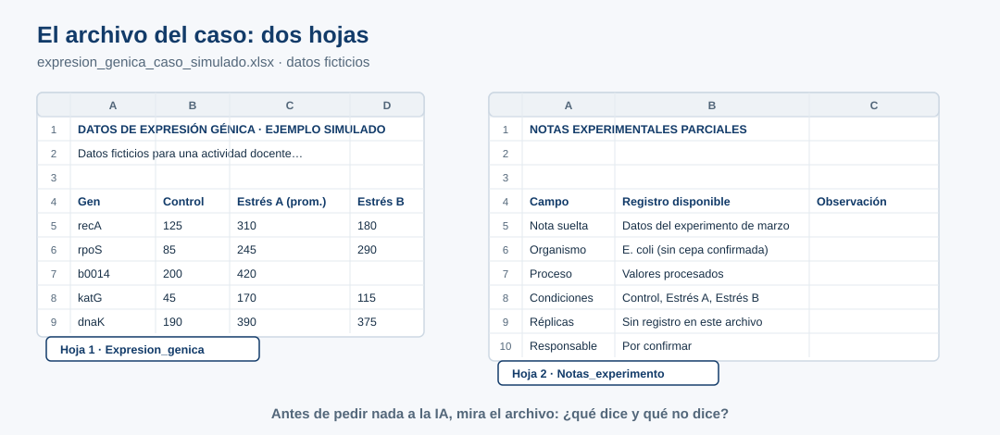
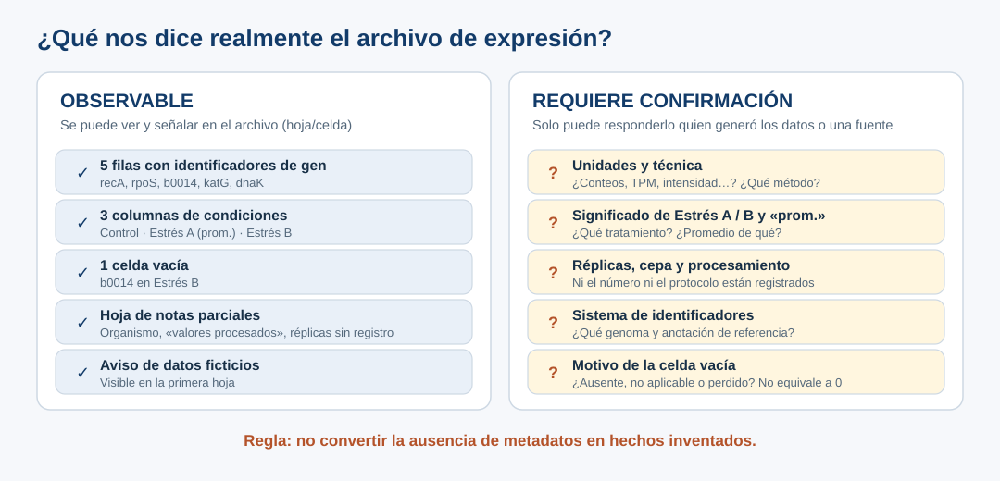

::: {.etiqueta-pagina .antes}
Antes o durante el taller
:::

::: {.en-un-minuto}
- Una investigadora debe preparar un Excel de expresión génica «siguiendo FAIR», pero faltan datos de contexto.
- La tarea es **distinguir lo que el archivo muestra de lo que hay que confirmar**, sin inventar.
- El producto es un diagnóstico de cuatro asuntos.
:::

## Escenario

Una investigadora prepara un artículo y recibe una solicitud: «Los datos de expresión génica deben seguir los principios FAIR». Tiene una tabla pequeña con cinco filas de genes y tres columnas de condiciones, pero le faltan datos esenciales de contexto experimental.

**Nuestra tarea no es fabricar metadatos para completar una tabla.** Es reconocer qué información está disponible, cuál falta, quién podría confirmarla y qué principios o documentación externa ayudan a organizar el trabajo.

Descarga el [Excel simulado](../descargas/expresion_genica_caso_simulado.xlsx). Tiene dos hojas: los datos y unas notas experimentales parciales. Una nota visible indica que los datos son ficticios. Si tu asistente no acepta archivos, usa la [versión en texto](../descargas/expresion_genica_caso_simulado.txt).

{fig-alt="Vista de las dos hojas del Excel. Hoja 1, Expresion_genica: título, nota de datos ficticios y una tabla con columnas Gen, Control, Estrés A (prom.) y Estrés B para recA 125, 310, 180; rpoS 85, 245, 290; b0014 200, 420 y celda vacía; katG 45, 170, 115; dnaK 190, 390, 375. Hoja 2, Notas_experimento: nota suelta, datos del experimento de marzo; organismo, E. coli sin cepa confirmada; proceso, valores procesados; condiciones, Control, Estrés A, Estrés B; réplicas, sin registro en este archivo; responsable, por confirmar."}

## Qué observar sin inventar

| Elemento | Pregunta que debes hacerte |
|---|---|
| Cinco identificadores: `recA`, `rpoS`, `b0014`, `katG`, `dnaK` | ¿Qué referencia genómica o sistema de identificadores se utilizó? |
| `Control`, `Estrés A (prom.)`, `Estrés B` | ¿Qué tratamientos representan? ¿Qué significa `prom.`? |
| Una celda vacía en `Estrés B` para `b0014` | ¿Es dato ausente, no aplicable o perdido? Nunca interpretarlo automáticamente como 0. |
| Valores numéricos sin unidad confirmada | ¿Qué miden, en qué unidades y bajo qué procedimiento? |
| Notas que dicen «valores procesados» | ¿Qué procesamiento se realizó y dónde está registrado? |
| Organismo «E. coli (sin cepa confirmada)» | ¿Qué cepa y qué genoma de referencia corresponden a los datos? |
| «Datos del experimento de marzo» y responsable «por confirmar» | ¿De qué año son y quién puede confirmar la información? |

::: {.callout-note}
## Sobre la identidad génica
No asumas equivalencias entre `b0014` y otro símbolo génico sin confirmar cepa, ensamblaje y anotación. La coincidencia biológica sugerente no es una comprobación documental.
:::

{fig-alt="Dos paneles. Observable: cinco filas con identificadores de gen, tres columnas de condiciones, una celda vacía, una hoja de notas parciales y el aviso de datos ficticios. Requiere confirmación: unidades y técnica, significado de Estrés A, Estrés B y prom., réplicas, cepa y procesamiento, sistema de identificadores y motivo de la celda vacía. Regla: no convertir la ausencia de metadatos en hechos inventados."}

## FAIR como contexto, no como certificado

Según Wilkinson et al. (2016) [R5], los principios FAIR plantean cuatro preguntas:

- **F — Findable:** ¿cómo se descubrirían y citarían los datos?
- **A — Accessible:** ¿qué protocolos y condiciones regulan el acceso? FAIR no significa necesariamente acceso abierto irrestricto.
- **I — Interoperable:** ¿son interpretables los identificadores, términos, variables y formatos?
- **R — Reusable:** ¿se conoce suficiente sobre procedencia, método, contexto y licencias para reutilizarlos?

La existencia de un CSV o de un README no prueba conformidad FAIR. Una fuente externa puede explicar un estándar; **no puede reconstruir tratamientos y réplicas que faltan en los registros experimentales**.

## Producto esperado

Una tabla de diagnóstico limitada a cuatro asuntos (unidades, condiciones, réplicas y celda faltante), tres preguntas prioritarias, una comprobación documental externa y una bitácora de decisiones.

Los identificadores, el procesamiento, la cepa y la responsabilidad quedan **fuera del alcance de P5** por el límite de esta práctica, no porque sean menos importantes. Regístralos como exclusiones en la [Bitácora mínima 4D](07-bitacora.qmd).

Para mirar la hoja sin salir del navegador puedes abrir el [Explorador FAIR](../interactivos/explorador_fair.html){target="_blank"}. El diagnóstico se elabora en tu asistente.
