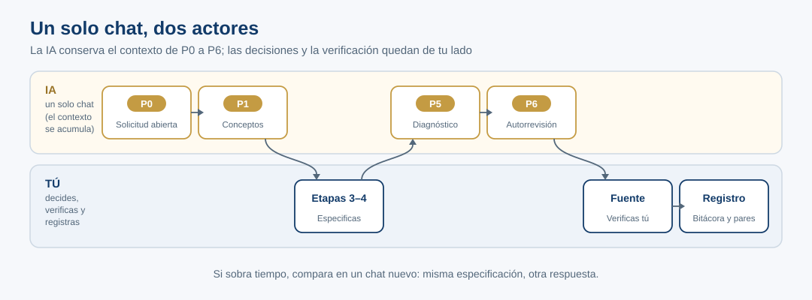
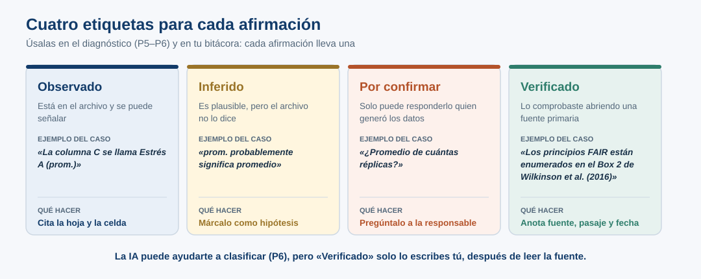

::: {.etiqueta-pagina .durante}
Durante el taller · práctica de cierre
:::

::: {.en-un-minuto}
- Recorres las **seis etapas** del método con la IA, en **un solo chat**, con el Excel del [caso de estudio](04-caso-fair.qmd).
- Cuatro prompts (**P0, P1, P5 y P6**); la especificación y la verificación con la fuente las haces tú.
- Cierras con el diagnóstico del chat y la [Bitácora mínima 4D](07-bitacora.qmd).
:::

En el [caso de estudio](04-caso-fair.qmd) conociste el encargo, miraste los datos por tu cuenta y anotaste lo que no puedes saber con el archivo. Ahora recorres las seis etapas del método con la IA. Ten a la mano esa lista: te servirá para comparar.

**Antes de empezar, descarga la [plantilla de la bitácora](../descargas/bitacora-minima-4d.md){download="bitacora-minima-4d.md"}** y ábrela en un editor de texto junto al chat. Al final de cada paso hay un recuadro «Para tu bitácora» que corresponde a una sección del archivo: anota en el momento, con la respuesta todavía en pantalla.

Los **cuatro prompts se ejecutan en un mismo chat**, conservando las respuestas anteriores. La numeración sigue la del taller: **P2–P4 no son prompts**; corresponden a la especificación y a la decisión de delegar, que resuelves tú. P1, P5 y P6 muestran sus componentes con etiquetas (Contexto, Objetivo, Tarea…), como la versión B de [Del problema al prompt](03b-estructura-prompt.qmd); puedes copiarlos así. Completar la práctica **no certifica** que un conjunto de datos cumpla los principios FAIR.

[Descargar el Excel](../descargas/expresion_genica_caso_simulado.xlsx) · [Plantilla de la bitácora](../descargas/bitacora-minima-4d.md){download="bitacora-minima-4d.md"} · [Versión en texto](../descargas/expresion_genica_caso_simulado.txt) · [Tarjeta de práctica](tarjeta-practica.qmd)

{fig-alt="Dos carriles. Carril de la IA, un solo chat donde se acumula el contexto: P0 solicitud abierta, P1 conceptos, P5 diagnóstico y P6 autorrevisión. Carril de la persona: entre P1 y P5 escribes la especificación y decides qué delegar; después de P6 abres una fuente y registras el resultado en la bitácora."}

## Las etapas y las 4D en esta práctica

Cada paso corresponde a una etapa del [método](03-metodo.qmd) y ejercita sobre todo una o dos competencias del [marco 4D](03-metodo.qmd#ai-fluency-4d-marco-de-competencias):

| Paso | Etapa | Competencia 4D |
|---|---|---|
| 1. P0 | Necesidad | **Discernment** (discernimiento) |
| 2. P1 | Vocabulario | **Discernment** (discernimiento) |
| 3. Especificación | Especificación | **Delegation** (delegación) y **Description** (descripción) |
| 4. P5, P6 y fuente | Colaboración y Verificación | **Discernment** (discernimiento) y **Diligence** (diligencia) |
| 5. Registro | Registro | **Diligence** (diligencia) |

::: {.callout-note collapse="true"}
## Archivos de las actividades anteriores (opcional)

Las actividades anteriores descargan un Markdown en tu equipo. Ábrelos si te sirven para recordar tu propio trabajo. Puedes consultarlos a mano. Esta práctica no pide subirlos al asistente ni entregarlos.

- `reporte_que_falta_por_definir_caso_A.md` o `reporte_que_falta_por_definir_caso_B.md`: preguntas y decisiones que marcaste como pendientes al precisar una solicitud.
- `reporte_del_prompt_caso_A.md` o `reporte_del_prompt_caso_B.md`: decisiones que tomaste al formular instrucciones y las versiones que guardaste.
- `Discernimiento_IA_AAAA-MM-DD.md`: criterios con los que evaluaste qué aceptar, corregir o dejar pendiente en una respuesta de IA.

Si no descargaste alguno, sigue con lo que recuerdes. Si además usaste el Explorador FAIR, su reporte se llama `explorador-fair-reporte.md` y también puede consultarse. Esos archivos son apoyo del proceso. Los productos de la sesión son el diagnóstico de este chat y la bitácora.
:::

## Paso 1 · Necesidad: el encargo abierto (P0)

*4D · Discernment (discernimiento): evalúas qué hace la IA con un encargo abierto.*

Abre un chat nuevo, adjunta el Excel y dale a la IA el encargo tal como llegó:



P0 está **incompleto a propósito**: es el encargo tal como llegó, sin los componentes que viste en [Del problema al prompt](03b-estructura-prompt.qmd). Así puedes ver qué hace la IA cuando tiene que decidir por su cuenta.

::: {.callout-note}
## Pausa antes de P1
Anota qué hizo la IA: ¿preguntó, explicó, sugirió archivos, atribuyó un significado experimental no demostrado? Compáralo con lo que tú entendiste del encargo en el caso de estudio. Que una respuesta sea útil no la vuelve automáticamente publicable.
:::

::: {.callout-tip}
## Para tu bitácora
- ¿Qué hizo la IA: preguntó, explicó, propuso archivos, inventó algo?
- ¿Coincide con lo que tú entendiste del encargo?
:::

## Paso 2 · Vocabulario: los conceptos (P1)

*4D · Discernment (discernimiento): comparas su explicación con lo que tú observaste.*



En el caso anotaste tres cosas que no puedes saber con el archivo y leíste una orientación breve sobre FAIR. Compara: ¿la lista de la IA coincide con la tuya? ¿Señaló algo que tú no viste? ¿Dio por hecho algo que el archivo no dice, como unidades, tratamientos o «prom.» como promedio?

::: {.callout-tip}
## Para tu bitácora
- Copia tu lista de tres cosas que no se pueden saber con el archivo.
- Anota algo que la IA señaló y tú no habías visto, y algo que dio por hecho sin evidencia.
:::

## Paso 3 · Especificación: la escribes tú

*4D · Delegation (delegación) y Description (descripción): decides qué encargas y cómo lo dices.*

El resultado y el alcance ya los conoces por [Qué vas a producir](04-caso-fair.qmd#qué-vas-a-producir); aquí los conviertes en tu especificación. Si lo necesitas, revisa los componentes de [Del problema al prompt](03b-estructura-prompt.qmd) y el reporte de «De la solicitud al prompt». Elige los que sirvan para un diagnóstico documental: objetivo, contexto, tarea, salida, restricciones y verificación. El rol es opcional.

**Escríbela tú, sin pedir a la IA que tome las decisiones.** Tiene dos partes: lo que le dices a la IA y lo que te guardas para evaluar su respuesta.

**A. Lo que le dices a la IA** (lo pegarás dentro de P5):

- Resultado buscado: **diagnóstico documental**, no depósito ni certificación.
- Alcance: **unidades, condiciones, réplicas y celda vacía**.
- Evidencia aceptable: celda o nota del archivo, o fuente primaria externa, indicando qué se consultó.
- Qué delegas: inventariar evidencia y preguntas, organizar una tabla y proponer próximos pasos.
- Límites: no completar vacíos con cero, no inventar metadatos, no suponer que «prom.» es promedio.

**B. Lo que te guardas para evaluar** (no se pega; lo usas en el paso 4 para revisar lo que responda la IA):

- Qué confirmas tú: la realidad experimental, las unidades, el protocolo, las personas responsables, la publicación y las licencias.
- Criterio de aceptación: cada afirmación lleva observado, inferido o por confirmar, con su ubicación en el archivo; «verificado» solo lo asignas tú, después de consultar la fuente.

::: {.callout-note collapse="true"}
## Ejemplo de especificación (ábrelo solo si te atoras)

**A. Lo que pego en P5**

- **Resultado buscado:** un diagnóstico documental de lo que falta saber; no un paquete para depositar ni una declaración de cumplimiento FAIR.
- **Alcance:** solo las unidades de los valores, qué significan Control, Estrés A y Estrés B, las réplicas y la celda vacía de `b0014` en Estrés B. Quedan fuera los identificadores, la cepa y el procesamiento.
- **Evidencia aceptable:** una celda o nota del Excel, indicando hoja y celda, o una fuente primaria que yo consulte.
- **Qué te pido:** que hagas el inventario de evidencia, organices la tabla y propongas preguntas y siguientes pasos.
- **Límites:** no rellenes la celda vacía con cero, no inventes metadatos y no supongas que «prom.» significa promedio.

**B. Lo que me guardo para evaluar**

- **Qué confirmo yo:** con la responsable del experimento, las unidades, los tratamientos y las réplicas; yo decido qué se publica.
- **Criterio de aceptación:** acepto la tabla si cada afirmación lleva observado, inferido o por confirmar, con su ubicación, y si nada aparece como verificado sin una fuente que yo haya abierto.

Tu versión puede ser distinta; lo importante es que las decisiones sean tuyas.
:::

**Antes de P5, copia la parte A.** La pegarás dentro de P5, en el lugar indicado; si no la pegas, la IA no la conoce. La parte B no se pega: la usarás en el paso 4 para decidir qué aceptas.

::: {.callout-tip}
## Para tu bitácora
Escribe tu especificación directamente en la sección del paso 3 de la plantilla: la parte A y la parte B. De ahí copias la parte A para pegarla en P5.
:::

## Paso 4 · Colaboración y verificación: diagnóstico, autorrevisión y contraste

*4D · Discernment (discernimiento) y Diligence (diligencia): evalúas el diagnóstico y no marcas nada como verificado sin fuente.*

Cada afirmación del diagnóstico lleva una de cuatro etiquetas. P6 marca las que requieren verificación externa. **Solo tú puedes cambiarlas a «Verificado».**

{fig-alt="Cuatro tarjetas. Observado: está en el archivo y se puede señalar; ejemplo, la columna C se llama Estrés A (prom.); qué hacer: citar hoja y celda. Inferido: plausible pero el archivo no lo dice; ejemplo, prom. probablemente significa promedio; qué hacer: marcarlo como hipótesis. Por confirmar: solo puede responderlo quien generó los datos; ejemplo, ¿promedio de cuántas réplicas?; qué hacer: preguntarlo a la responsable. Verificado: comprobado abriendo una fuente primaria; ejemplo, los principios FAIR están enumerados en el Box 2 de Wilkinson et al. 2016; qué hacer: anotar fuente, pasaje y fecha."}





P6 es **autorrevisión**: la IA relee su respuesta y te dice qué habría que comprobar, pero no consulta ninguna fuente. Una referencia bibliográfica existente tampoco prueba que sustente la frase que se le atribuye. Verificar lo haces tú.

{fig-alt="Dos columnas separadas por un signo de distinto. P6, autorrevisión de la IA: la IA relee su respuesta, clasifica lo observado, inferido y por confirmar, corrige no existe por no está documentado y sugiere qué fuente revisar; su resultado es una lista de lo que habría que comprobar. Tú, verificación independiente: una persona abre y lee la fuente, localiza el pasaje y anota fecha, interpretación y limitaciones; su resultado es respalda, contradice o no permite decidir. Ambas columnas llevan a la bitácora; si no se abrió la fuente se anota pendiente."}

### Tu verificación con la fuente (obligatoria) {#verificacion}

::: {.callout-important}
## Prioridad
Si tienes que elegir, prioriza esta verificación sobre leer completa la respuesta a P6.
:::

**Afirmación para comprobar:** «FAIR exige que todos los datos sean completamente abiertos».

Es una confusión frecuente sobre FAIR, y puede aparecer, dicha así o de otra forma, en lo que te respondió la IA: revisa si está en sus respuestas. Si P6 te propuso otra afirmación para contrastar, puedes verificarla después con los mismos pasos.

1. Abre [Wilkinson et al. (2016)](https://doi.org/10.1038/sdata.2016.18), la fuente primaria. Si quieres, usa [GO FAIR — FAIR Principles](https://www.gofair.foundation/fair-principles) como complemento.
2. Localiza qué dice el artículo sobre el acceso a los datos. En Wilkinson et al., el **Box 2** enumera todos los principios; lee los que empiezan con **A**: A1, A1.1, A1.2 y A2.
3. Anota con tus palabras **qué dice realmente** el texto.
4. Registra en tu bitácora la fuente (título y URL), la fecha de consulta, la sección o el pasaje, qué dice realmente y las limitaciones de tu lectura.
5. Concluye **respalda**, **contradice**, **no permite decidir** o **pendiente**, y justifica tu conclusión con el pasaje consultado.

::: {.callout-warning}
## Regla de evidencia
Si no pudiste abrir y leer la fuente, tu conclusión es **«pendiente»**. El enlace que sugiere una IA no prueba que la consulta ocurrió.
:::

::: {.callout-note collapse="true"}
## Si quieres profundizar (ábrelo después de llegar a tu conclusión)
Mons et al. (2017) [[R13](08-referencias.qmd#r13)] dedica una sección a la relación entre FAIR y los datos abiertos: [*Cloudy, increasingly FAIR*](https://doi.org/10.3233/ISU-170824). Compara lo que dice con tu conclusión.
:::

### Revisa el diagnóstico

Revisa la tabla de P5 y la autorrevisión de P6 con tu **criterio de aceptación** (parte B del paso 3): ¿cada afirmación tiene su etiqueta y su ubicación? ¿Algo aparece como confirmado sin evidencia?

El producto de este chat es el **diagnóstico FAIR preliminar**: unidades, condiciones, réplicas y la celda vacía, con lo observado, lo inferido y lo que falta confirmar.

::: {.callout-tip}
## Para tu bitácora
- ¿La tabla de P5 cumple tu criterio de aceptación? ¿Qué corregiste o no aceptaste?
- Tu verificación con la fuente: título y URL, fecha, pasaje, qué dice, limitaciones y conclusión. Si no abriste la fuente, escribe «pendiente».
:::

## Paso 5 · Registro: cierra tu bitácora

*4D · Diligence (diligencia): respondes por lo que queda abierto.*

Completa las secciones «Paso 5 · Registro» y «Cierre» de tu bitácora y guarda el archivo; en [Bitácora mínima 4D](07-bitacora.qmd) tienes una lista para revisarla antes de terminar. Ese archivo es el segundo producto de la sesión.

::: {.callout-tip}
## Para tu bitácora
- Qué queda pendiente y quién debe confirmarlo.
- Las exclusiones: identificadores, procesamiento, cepa y persona responsable.
:::

## Cierre

Escribe un problema de tu trabajo al que aplicarías estas etapas, sin resolverlo ahora. Anótalo en la sección «Cierre» de tu bitácora.

Pregunta de cierre: **«La IA puede hacerlo. ¿Tú sabes qué hizo, por qué lo hizo y cómo comprobarlo?»**

Si el equipo docente comparte un formulario de opinión, responde de forma anónima: *¿Qué harás distinto la próxima vez que delegues algo a la IA?* y *¿Qué parte del taller te costó más?* Tus respuestas sirven para mejorar el taller.

## ¿Vas bien? Autoevaluación

No hay una respuesta única. Un buen resultado cumple con esto:

::: {.autoevaluacion}
- Escribiste la **especificación tú**, antes de P5.
- El diagnóstico cubre **unidades, condiciones, réplicas y la celda vacía**, y cada afirmación lleva **una etiqueta** (observado, inferido, por confirmar, verificado).
- Ninguna afirmación dice **«verificado»** sin una fuente que abriste tú, con pasaje y fecha.
- Distinguiste **«no existe»** de **«no está documentado»**.
:::

## Ampliación opcional

Usa un **segundo chat limpio** con el mismo Excel y tu especificación final, y compara la respuesta con la de P0. Recuerda que una misma instrucción puede dar respuestas distintas cada vez: la comparación muestra diferencias, pero no prueba que las causó tu especificación.

**La cita del 80 %.** Aplica los pasos de [tu verificación](#verificacion) a la respuesta simulada del [ejemplo 2](02-ejemplos.qmd#ejemplo-2.-evidencia-sobre-fair-y-reproducibilidad): busca en el artículo si contiene realmente ese resultado y distingue una cita auténtica de una atribución no sustentada.
