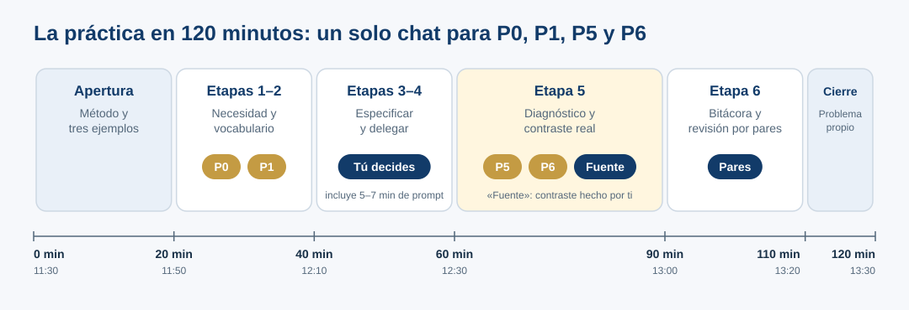

::: {.etiqueta-pagina .durante}
Durante el taller · guía de la práctica (120 min)
:::

::: {.en-un-minuto}
- Cuatro prompts (**P0, P1, P5 y P6**) en **un solo chat**; las etapas 3 y 4 las resuelves tú.
- La **verificación con una fuente primaria la haces tú**: la autorrevisión de la IA (P6) no basta.
- Todo queda en la **bitácora**, para que otra persona pueda reconstruir el proceso.
:::

Los **cuatro prompts principales se ejecutan en un mismo chat**, conservando las respuestas anteriores. La exploración, la especificación humana, la verificación y la bitácora completan las seis etapas. El término «antes del prompt» no prohíbe usar IA para aprender desde el inicio.

La numeración sigue la de la versión completa del taller: **P2–P4 corresponden a las etapas 3 y 4, que aquí haces tú** sin pedírselas a la IA.

{fig-alt="Línea de tiempo de 120 minutos. 0–20 min: apertura, método y tres ejemplos. 20–40: etapas 1 y 2 con P0 y P1. 40–60: etapas 3 y 4, decisiones propias e incluye 5 a 7 minutos de prompt. 60–90: etapa 5 con P5, P6 y contraste con una fuente hecho por la persona. 90–110: etapa 6, bitácora y revisión por pares. 110–120: cierre con un problema propio."}

[Descargar Excel para participantes](../descargas/expresion_genica_caso_simulado.xlsx) · [Plantilla de bitácora (.docx)](../descargas/bitacora-plantilla.docx) · [Ver bitácora](07-bitacora.qmd)

## Desarrollo de la práctica

**Duración total del taller:** 120 min. **Actividad:** diagnóstico preliminar de documentación. Trabaja con el [Excel simulado](../descargas/expresion_genica_caso_simulado.xlsx). **Los datos son ficticios** y no son resultados publicables. Usa **un solo chat** para P0, P1, P5 y P6, y conserva la secuencia. Puedes usar Google Docs o Markdown para la bitácora. ¿Prefieres tenerlo todo en una hoja? Usa la [tarjeta de práctica](tarjeta-practica.qmd).

{fig-alt="Dos carriles. Carril de la IA, un solo chat donde se acumula el contexto: P0 solicitud abierta, P1 conceptos, P5 diagnóstico y P6 autorrevisión. Carril de la persona: etapas 3 y 4, especificas y decides, entre P1 y P5; después de P6, verificas tú con una fuente y registras en la bitácora y con pares."}

## Min 0–20 (11:30–11:50) · Apertura y método

Analiza los [tres ejemplos](02-ejemplos.qmd): operación ambigua, cita real con afirmación no respaldada y metadatos fabricados. Se presentan las [seis etapas](03-metodo.qmd) del trabajo con IA.

## Min 20–40 (11:50–12:10) · Etapas 1 y 2: necesidad y vocabulario

Adjunta [el Excel simulado](../descargas/expresion_genica_caso_simulado.xlsx) y escribe:



::: {.callout-note}
## Pausa antes de P1
Registra qué hizo la IA: ¿preguntó, explicó, sugirió archivos, atribuyó un significado experimental no demostrado? Que una respuesta sea útil no la vuelve automáticamente publicable.
:::



**Puesta en común (3 min).** Cada persona usa un asistente distinto: aprovechemos la diferencia. ¿A quién le hizo preguntas antes de responder? ¿A quién le entregó archivos? ¿Alguien recibió unidades o tratamientos que el Excel no menciona?

## Min 40–60 (12:10–12:30) · Etapas 3 y 4: especificar, construir instrucciones y delegar

**Primeros 5–7 minutos:** consulta [Del problema al prompt](03b-estructura-prompt.qmd) y realiza la actividad breve. Elige los componentes necesarios para un diagnóstico documental: objetivo, contexto, tarea, salida, restricciones y verificación. El rol es opcional. **Este segmento sustituye parte de la explicación de estas etapas: no añade tiempo al taller.**

**Luego escribe en la [sección 3 de tu bitácora](07-bitacora.qmd#especificacion-propia), sin pedir a la IA que tome las decisiones por ti:**

- Resultado buscado: **diagnóstico documental**, no depósito ni certificación.
- Alcance: **unidades, condiciones, réplicas y celda vacía**.
- Evidencia aceptable: celda/nota del archivo o fuente primaria externa, indicando qué se consultó.
- Qué delego a IA: inventariar evidencia y preguntas, organizar una tabla y proponer próximos pasos.
- Qué confirmo como investigador/a: realidad experimental, unidades, protocolo, responsables, publicación, licencias.
- Límites: no completar vacíos con cero, no inventar metadatos, no suponer que «prom.» es promedio.
- Criterio de aceptación: cada afirmación etiquetada como observada / inferida / pendiente / verificación externa.

**[Marco 4D](03-metodo.qmd#ai-fluency-4d-marco-de-competencias), en breve:** Delegation = repartir tareas; Description = especificar entradas y restricciones; Discernment = evaluar; Diligence = documentar y responder por decisiones.

**Punto de atención:** cuando ejecutes P5, anota en tu bitácora qué componentes de tu especificación aportaron claridad y qué responsabilidad de verificación conservas tú.

## Min 60–90 (12:30–13:00) · Etapa 5: diagnóstico, autocrítica y contraste real

En esta etapa, cada afirmación del diagnóstico lleva una de cuatro etiquetas. P6 marca las que requieren verificación externa; **solo tú puedes cambiarlas a «Verificado»**.

{fig-alt="Cuatro tarjetas. Observado: está en el archivo y se puede señalar; ejemplo, la columna C se llama Estrés A (prom.); qué hacer: citar hoja y celda. Inferido: plausible pero el archivo no lo dice; ejemplo, prom. probablemente significa promedio; qué hacer: marcarlo como hipótesis. Por confirmar: solo puede responderlo quien generó los datos; ejemplo, ¿promedio de cuántas réplicas?; qué hacer: preguntarlo a la responsable. Verificado: comprobado abriendo una fuente primaria; ejemplo, los principios FAIR están enumerados en el Box 2 de Wilkinson et al. 2016; qué hacer: anotar fuente, pasaje y fecha."}





::: {.callout-important}
## Actividad obligatoria · la haces tú, no basta con P6
Contrasta la afirmación **«FAIR exige que todos los datos sean completamente abiertos»** con la fuente primaria. Sigue los pasos en [Verificación independiente](06-verificacion.qmd#actividad-obligatoria). **Si no accedes a la fuente, escribe «pendiente», nunca «verificado».** Si el tiempo no alcanza, prioriza esta verificación sobre leer completa la respuesta a P6.
:::

## Min 90–110 (13:00–13:20) · Etapa 6: registro y revisión por pares

Completa [la bitácora](07-bitacora.qmd); intercambia con otra persona y comprueba que pueda reconstruir qué se pidió, qué respondió la IA, cómo se contrastó y qué sigue pendiente. Una observación constructiva y una pregunta por pareja. *En línea:* comparte tu bitácora con permiso de comentario o pega el enlace en el chat de la reunión.

## Min 110–120 (13:20–13:30) · Cierre

Escribe un problema propio al que aplicarías estas seis etapas, sin necesidad de resolverlo; usa la sección [Transferencia a un problema real](07-bitacora.qmd#transferencia) de la bitácora.

Pregunta de cierre: **«La IA puede hacerlo. ¿Tú sabes qué hizo, por qué lo hizo y cómo comprobarlo?»**

**Antes de irte (2 min):** responde, de forma anónima, en el formulario que compartiremos en la sesión: *¿Qué harás distinto la próxima vez que delegues algo a la IA?* y *¿Qué parte del taller te costó más?* Tus respuestas sirven para mejorar el taller: es su primera edición con participantes.

## ¿Vas bien? Autoevaluación

No hay una respuesta única, pero un buen resultado cumple con esto:

::: {.autoevaluacion}
- Tu bitácora registra **qué hizo la IA con P0** antes de que la corrigieras.
- Escribiste la **especificación tú**, antes de P5.
- El diagnóstico tiene **cuatro asuntos** y cada afirmación lleva **una etiqueta** (observado, inferido, por confirmar, verificado).
- Ninguna afirmación dice **«verificado»** sin una fuente que abriste tú, con pasaje y fecha.
- Distinguiste **«no existe»** de **«no está documentado»**.
- Otra persona pudo **reconstruir tu proceso** leyendo la bitácora.
:::

## Si sobra tiempo

Usa un **segundo chat limpio** con el mismo Excel y la especificación final. Compara P0 y la respuesta final como demostración informal; no atribuyas causalidad experimental a esa comparación.
