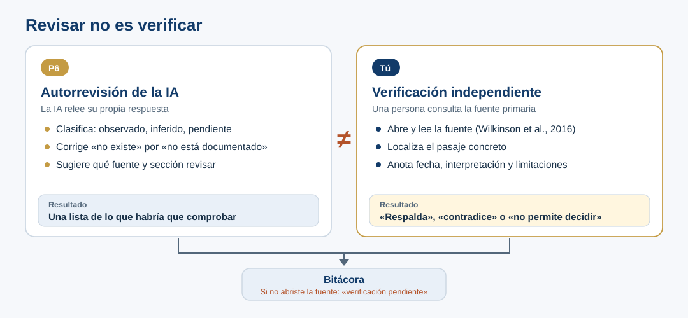

::: {.etiqueta-pagina .durante}
Durante el taller
:::

::: {.en-un-minuto}
- P6 es **autorrevisión**: dice qué habría que comprobar, no lo comprueba.
- Verificar es **abrir la fuente, localizar el pasaje y anotar qué dice**.
- Si no pudiste abrirla, escribe **«pendiente»**, nunca «verificado».
:::

## Qué significa contrastar realmente

P6 pide a la IA una auditoría de su respuesta: identifica lo observado, lo inferido y lo pendiente. **Eso no equivale a consultar una fuente independiente.** Una referencia bibliográfica existente tampoco prueba que sustente la frase que se le atribuye.

{fig-alt="Dos columnas separadas por un signo de distinto. P6, autorrevisión de la IA: la IA relee su respuesta, clasifica lo observado, inferido y pendiente, corrige no existe por no está documentado y sugiere qué fuente revisar; su resultado es una lista de lo que habría que comprobar. Tú, verificación independiente: una persona abre y lee la fuente, localiza el pasaje y anota fecha, interpretación y limitaciones; su resultado es respalda, contradice o no permite decidir. Ambas columnas llevan a la bitácora; si no se abrió la fuente se anota verificación pendiente."}

### Actividad obligatoria

**Afirmación para comprobar:** «FAIR exige que todos los datos sean completamente abiertos».

1. Abre primero [Wilkinson et al. (2016)](https://doi.org/10.1038/sdata.2016.18), la fuente primaria. Si quieres, usa [GO FAIR — FAIR Principles](https://www.gofair.foundation/fair-principles) como complemento.
2. Localiza la parte que describe el principio **Accessible** y las condiciones de acceso (en Wilkinson et al., el **Box 2** enumera todos los principios: lee A1.1, A1.2 y A2). Para una aclaración explícita sobre FAIR y apertura, puedes consultar también Mons et al. (2017) [R13].
3. Anota **qué dice realmente** el texto; distingue acceso bajo condiciones de acceso libre e irrestricto.
4. Registra título, URL, fecha de consulta, sección o párrafo, interpretación y limitaciones.
5. Concluye: «respalda», «contradice» o «no permite decidir», justificando tu decisión con el pasaje consultado.

::: {.callout-warning}
## Regla de evidencia
Si no pudiste abrir y leer la fuente, escribe **«verificación externa pendiente»**. El enlace sugerido por una IA no es prueba de que la consulta ocurrió.
:::

## Ejercicio opcional: la cita del 80 %

Aplica los mismos pasos a la respuesta simulada del [ejemplo 2](02-ejemplos.qmd#ejemplo-2.-la-referencia-existe-pero-no-demuestra-lo-que-se-le-atribuye): busca en el artículo si contiene realmente ese resultado y distingue una cita auténtica de una atribución no sustentada.

## Registro de la verificación

Anota la comprobación en la estación Discernment de la [Bitácora mínima 4D](07-bitacora.qmd): la afirmación, cómo la contrastaste, la evidencia y el estado. Si no abriste la fuente, deja el estado en pendiente.
